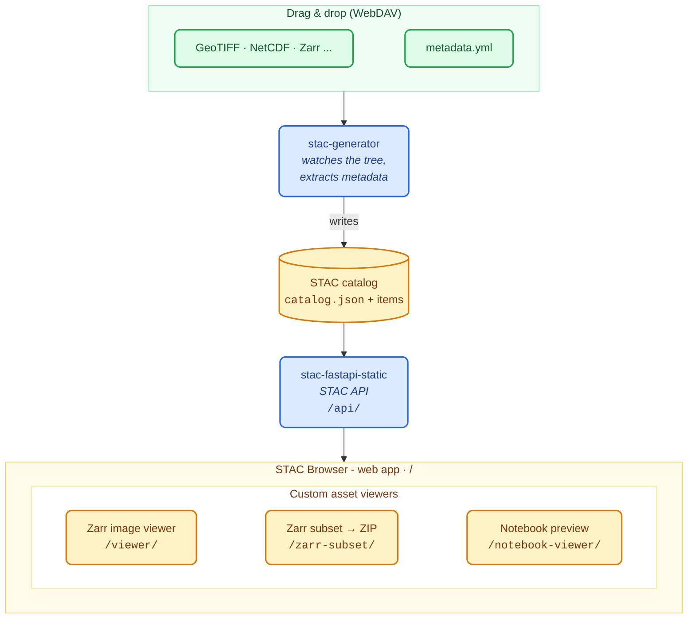

# STAC Stack

A ready-to-run stack for publishing georeferenced scientific data (**GeoTIFF, NetCDF, Zarr**, ...) as a browsable, queryable STAC catalog.

Drop your assets in a folder, add a `metadata.yml` next to them, and the stack does the rest: it extracts the metadata, builds a STAC catalog, serves a STAC API, and gives you a [Stac Browser (by Radiant Earth)](https://github.com/radiantearth/stac-browser) with custom viewers and tools built in :
* A **Zarr viewer** in the browser
* A **preview of notebooks**
* A **streaming subset/ZIP for Zarr datasets**
* Automatic translation of **Thredds XML catalogs to Zarr**

## Live demo

We developped this projet to publish our own datasets, here :

[https://stac.webservice-energy.org/](https://stac.webservice-energy.org/)

## How it works



The generator never edits your data. It produces a separate catalog tree under
`volumes/catalog/`, which is regenerated automatically whenever the content of
`volumes/data/` changes.


## Projects in this stack

| Project | What it does | Origin | Our additions |
|---|---|---|---|
| [**stac-browser**](./services/stac-browser) | STAC search web app: results, filters, map, item pages | Fork of [eu-cdse/stac-browser-cdse](https://github.com/eu-cdse/stac-browser-cdse), itself a fork of [radiantearth/stac-browser](https://github.com/radiantearth/stac-browser) | branding, catalog wiring, custom viewer integrations |
| [**stac-generator**](https://git.sophia.minesparis.psl.eu/oie/stac-generator) | Walks the asset tree, reads `metadata.yml`, extracts spatial/temporal/band metadata, writes the STAC catalog. Also translates remote Thredds catalogs to STAC | OIE - own project | Whole project |
| [**zarr-viewer**](https://git.sophia.minesparis.psl.eu/oie/zarr-viewer) | Web viewer for Zarr v2/v3 image cubes, CF-convention aware | OIE - own project, built on [Zarrita](https://zarrita.dev/) | Whole project |
| [**zarr-subset-zip**](https://git.sophia.minesparis.psl.eu/oie/zarr-subset-zip) | HTTP API that subsets a Zarr cube and streams it as a ZIP | OIE - own project | Whole project |
| [**notebook-viewer**](./services/notebook-viewer) | Renders a Jupyter notebook in an iframe, for `application/x-ipynb+json` assets | OIE - own project, in-tree, built on [notebookjs](https://github.com/jsvine/notebookjs) | Whole project |
| [**stac-fastapi-static**](./services/stac-fastapi-static) | Serves a static STAC catalog as a STAC API | Fork of [fntb/stac-fastapi-static](https://github.com/fntb/stac-fastapi-static) | Packaging and integration |


## Setup

**Requirements:** Docker with Compose v2, `make`, `git`.

```bash
git clone --recurse-submodules https://git.sophia.minesparis.psl.eu/oie/stac-oie.git
cd stac-oie
cp .env.example .env
```

Edit `.env` - the essential variables:

| Variable | Default | Meaning |
|---|---|---|
| `HTTP_PORT` | `8000` | Port the stack is served on |
| `DOMAIN` | `stac.mysite.com` | Public hostname |
| `EXTERNAL_URL` | `https://${DOMAIN}/` | URL advertised inside STAC items (`http://localhost:${HTTP_PORT}/` if you have no TLS) |
| `WEBDAV_ADMIN` | - | WebDAV user allowed to write. Empty disables all writes |
| `WEBDAV_PASSWORD` | - | Password for that user |
| `NGINX_UID` / `NGINX_GID` | `1000` | Host uid/gid used to read the bind-mounted data |

Then:

```bash
make up       # pulls the published images and starts the stack
```

Open <http://localhost:8000/>: you will see the bundled example assets  already cataloged, browsable and previewable.

### Using your own data

Replace what is in `volumes/data/` with your own files, keeping a `metadata.yml`
in each folder. The generator watches the tree and rebuilds the catalog on the
fly - no restart needed.

- `volumes/data/` - **your assets and `metadata.yml` files.**
- `volumes/catalog/` - **generated. Do not edit by hand**: it is rewritten on every
  change and kept read-only inside the stack.

A minimal `metadata.yml`, at the root of the tree:

```yaml
id: my-catalog
title: My catalog
description: Datasets published by my team
children:
  - "campaign-2026"
```

And one inside each dataset folder:

```yaml
title: Campaign 2026
description: Raw acquisition tiles
items:
  - "*.tiff"
assets:
  - file: documentation.pdf
    name: documentation
    roles: ["doc"]
```

The generator infers extent, datacube shape and bands from the files themselves.
See the [stac-generator README](https://git.sophia.minesparis.psl.eu/oie/stac-generator)
for the full `metadata.yml` reference.


### Uploading over WebDAV

The stack exposes an authenticated WebDAV endpoint at `/dav`, so you can drag and drop directly from your OS file
manager. 

It shows two folders:
- `data/` - read/write. This is `volumes/data/`: drop your assets and
  `metadata.yml` files here.
- `catalog/` - read-only. The generated output, useful to debug or inspect: its
  `status.log` reads `OK` after a successful generation, or carries the error and
  traceback when one failed. A failed refresh never empties the folder: the
  previous catalog is kept and stays served.

Paste this URL into your file manager:

```
davs://<domain>/dav
```


Log in with `WEBDAV_ADMIN` and `WEBDAV_PASSWORD` from `.env`. If `WEBDAV_ADMIN` is
empty, writes are disabled entirely.

`davs://` is WebDAV over TLS, so it needs the `tls` profile described below.
Without TLS, use `dav://<domain>:<HTTP_PORT>/dav` instead. With `TLS=internal` the
certificate is self-signed and some clients refuse it; import the CA, or fall back
to `dav://` if that gets in the way.


### Https certificates & domain name

If you **already run a TLS reverse proxy** in front of this host, do nothing -
the stack speaks plain HTTP and your proxy terminates TLS.

Otherwise, Caddy can do it for you:

```bash
make up-tls
```

This adds Caddy on `:80`/`:443` and pins nginx to loopback, so Caddy becomes the
only reachable entry point. `TLS=internal` issues a self-signed certificate
(offline, browsers will warn); `TLS="acme you@example.com"` requests a real
Let's Encrypt certificate, which requires public inbound `80`/`443` and DNS
pointing at this host.

## Branding and configuration

Everything user-facing lives in `branding/` :

| File | Purpose |
|---|---|
| `branding/config.yaml` | Catalog title, colors, viewer defaults |
| `branding/logo-oie.png` | Logo shown in the browser header |
| `branding/favicon.svg` | Favicon |
| `branding/org.css` | CSS overrides |

Edit them and `make up` (or `docker compose restart browser`) to see the result.

## Author

[Raphaël Jolivet](mailto:raphael.jolivet@minesparis.psl.eu) @ [OIE - Mines Paris - PSL](https://www.oie.minesparis.psl.eu/)

## License

[MIT](./LICENSE)

